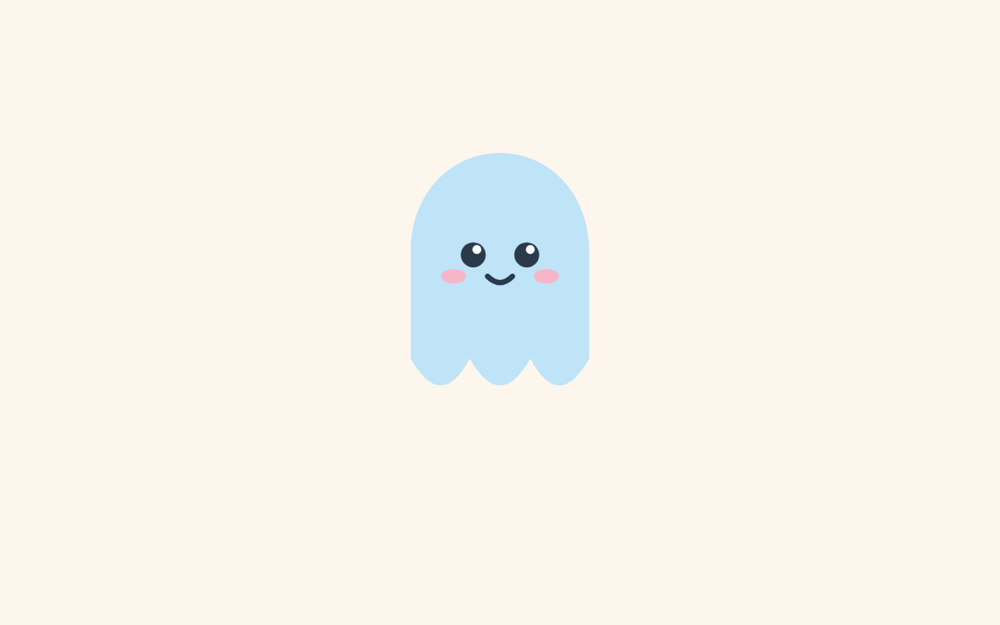

# blobby

a little dancing blob



## see blobby

Download or clone this repo, then open `index.html` in any browser.

```
git clone https://github.com/sediesimpson/blobby.git
cd blobby
open index.html
```

## How it's made

- **HTML + SVG** to draw blobby (body, face, cheeks, smile)
- **CSS keyframes** for each part of the animation
- **Easing** to make the motion feel natural
- **Squash and stretch** to make him feel soft and bouncy

## The show

1. **Peek**: leans in from the left edge, curious
2. **Enter**: waddles to centre stage
3. **Dance**: two hops and a twirl
4. **Waltz**: dances off to the right in 3/4 time
=======
a little dancing blob, built purely with html like the good old days
